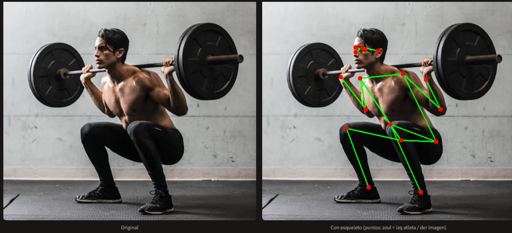

# AthletePose Analyzer

**Herramienta de caracterización postural automática para fotos de atletas.**

Combina pose estimation moderna (MoveNet de Google) con clasificación de contenido (MobileNetV2 preentrenada en ImageNet) para producir un análisis postural interpretado según el deporte detectado.

> Proyecto **Procesamiento de Imágenes** · Ciencia de Datos e IA · ISSD · 2026.



---

## ¿Qué hace?

Dada una foto estática de un atleta, el sistema:

1. **Detecta 17 keypoints articulares** (nariz, hombros, codos, muñecas, caderas, rodillas, tobillos) en formato estándar COCO.
2. **Calcula 6 ángulos articulares** clave: rodillas, codos y caderas.
3. **Clasifica el deporte** mediante una red neuronal preentrenada.
4. **Interpreta automáticamente** los ángulos contra rangos de referencia según el deporte.

Todo integrado en una app web interactiva con **Streamlit**.

---

## Stack técnico

| Tecnología | Rol |
|---|---|
| **MoveNet** (Google / TF Hub) | Pose estimation — 17 keypoints COCO |
| **MobileNetV2** (Keras) | Clasificación de contenido (ImageNet 1000 clases) |
| **NumPy** | Cálculo vectorial de ángulos |
| **Streamlit** | Interfaz web |
| **OpenCV** | Manipulación de imágenes |

---

## Instalación

### Requisitos
- Python 3.9 o superior
- Pip
- ~2 GB libres de disco (dependencias + modelos)

### Pasos

```bash


# 1. Crear y activar entorno virtual
python -m venv venv

# Windows
venv\Scripts\activate

# Linux / Mac
source venv/bin/activate

# 2. Instalar dependencias
pip install -r requirements.txt
```

---

## Uso

```bash
streamlit run app.py
```

La app se abre automáticamente en `http://localhost:8501`.

**Primera corrida:** se descargan los modelos preentrenados (MoveNet ~10 MB + MobileNetV2 ~14 MB). Puede tardar 20-60 segundos según conexión. Siguientes corridas: instantáneas (cache local).

### Pasos en la app

1. Subí una foto de un atleta (JPG, JPEG o PNG).
2. Ajustá el umbral de confianza si querés (default 0.3 es sensato).
3. Observá el pipeline completo:
   - Original vs imagen con esqueleto superpuesto.
   - Ángulos articulares medidos.
   - Clasificación del deporte (top-3 ImageNet).
   - Interpretación automática según categoría deportiva.

---

## Estructura del proyecto

athletepose-analyzer/
├── app.py # UI Streamlit y orquestación
├── pose.py # MoveNet + dibujo del esqueleto
├── classification.py # MobileNetV2
├── metrics.py # Ángulos + mapeo a categoría + interpretación
├── utils.py # Helpers (load_image)
├── requirements.txt # Dependencias pineadas
├── explicacion.md # Documento técnico completo
├── README.md # Este archivo
└── imagenes/ # Fotos de ejemplo y screenshots


Diseño **modular**: módulos de procesamiento no dependen de Streamlit. Separación estricta de responsabilidades.

---

## Casos de prueba

Se incluyen 4 imágenes de ejemplo en `imagenes/` que cubren los distintos comportamientos del sistema:

| # | Imagen | Comportamiento esperado |
|---|---|---|
| 1 | Sentadilla con barbell | ✅ Clasificación exitosa + interpretación aplicada (Weightlifting) |
| 2 | Yoga Warrior II | ℹ️ Fallback a "General" (ImageNet no cubre yoga) |
| 3 | Corredor en sprint | ℹ️ Fallback a "General" (modelo confunde con pelotas) |
| 4 | Ciclista en posición aero | ✅ Clasificación exitosa (Cycling) + limitación de sub-disciplina |

Detalle completo de cada caso en [`explicacion.md`](explicacion.md#7-casos-de-prueba-documentados).

---

## Limitaciones conocidas

- **Foto estática únicamente** — no analiza video ni series temporales.
- **MoveNet SinglePose** — detecta una sola persona (la más dominante).
- **ImageNet no cubre todas las actividades** — yoga, pilates, calistenia pueden caer en "General".
- **Rangos de referencia orientativos** — no constituyen diagnóstico clínico.

Discusión completa en [`explicacion.md`](explicacion.md#8-limitaciones-conocidas).

---

## Futuras mejoras

| Dirección | Habilitador técnico |
|---|---|
| Sub-categorías de ciclismo (ruta / TT / MTB) con rangos propios | Clasificador secundario |
| Análisis de video con pose temporal | OpenCV video + agregación temporal |
| Pose estimation en 3D | MediaPipe 3D o VideoPose3D |
| Multi-pose (varios atletas) | MoveNet MultiPose o YOLOv8-Pose |

---

## Autor

**Leandro Andiarena**
 Ciencia de Datos e IA — ISSD
 Noviembre 2026

---

## Licencia y uso académico

Proyecto desarrollado con fines académicos. Los modelos preentrenados (MoveNet, MobileNetV2) son propiedad de sus respectivos autores (Google / TensorFlow) y se usan bajo sus licencias originales. Las imágenes de ejemplo son propiedad de sus respectivos autores y se incluyen únicamente con fines demostrativos.
